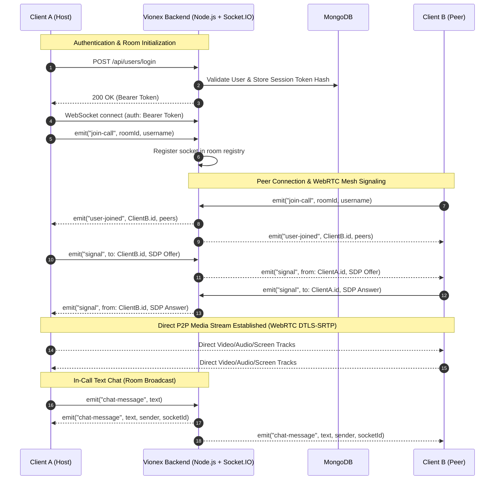

# Vionex — Backend API & WebRTC Signaling Server

> **GitHub Description:** High-performance Node.js & Socket.IO backend for Vionex, providing secure WebRTC mesh signaling, multi-device session authentication, and meeting activity history with MongoDB.

---

## 🚀 Overview

The **Vionex Backend** powers real-time WebRTC mesh conferencing and account management. It provides:
1. **Low-Latency WebSocket Signaling**: Facilitates SDP offer/answer exchanges and ICE candidate routing for peer-to-peer audio, video, and screen sharing.
2. **Session Security & Authentication**: Multi-device sessions secured with SHA-256 token hashing, bcrypt password encryption, and brute-force rate-limiting.
3. **Meeting History Management**: Persists past video calls with indexed pagination in MongoDB.
4. **Dynamic ICE Server Configuration**: Distributes STUN and optional TURN server configs dynamically to clients.

---

## 🏛️ System Architecture & Visual Flow



---

## 🛠️ Tech Stack

- **Runtime**: Node.js (ES Modules)
- **Framework**: Express.js
- **Real-Time Engine**: Socket.IO 4.x (WebSockets + Polling fallback)
- **Database & ODM**: MongoDB & Mongoose 8.x
- **Security & Cryptography**: Bcrypt, Node.js `crypto` (SHA-256 digests), `express-rate-limit`
- **Configuration**: Dotenv & Dotenvx

---

## 🔐 Environment Configuration

All environment configurations are managed via environment files. **Never commit actual `.env` files to git.** Reference `.env.example` for all variables:

| Variable | Type | Default (Dev) | Description |
| :--- | :--- | :--- | :--- |
| `NODE_ENV` | String | `development` | Active environment (`development` or `production`) |
| `PORT` | Number | `8080` | HTTP and WebSocket server port |
| `MONGO_URL` | String | `mongodb://127.0.0.1:27017/vionex` | MongoDB connection URI |
| `CLIENT_ORIGIN` | String | `http://localhost:5173` | Allowed frontend origin for CORS |
| `TURN_URL` | String | *(Optional)* | STUN/TURN server URL (e.g. Coturn/Xirsys) |
| `TURN_USERNAME` | String | *(Optional)* | TURN credential username |
| `TURN_CREDENTIAL` | String | *(Optional)* | TURN credential secret |

To set up your local environment:
```bash
cp .env.example .env.development
```

---

## 📡 REST API Reference

All protected endpoints require an `Authorization: Bearer <token>` header.

| Method | Endpoint | Auth Required | Description |
| :--- | :--- | :---: | :--- |
| `POST` | `/api/users/register` | No | Creates a new account with hashed password |
| `POST` | `/api/users/login` | No | Authenticates credentials and returns session token |
| `POST` | `/api/users/logout` | Yes | Terminates and revokes current active session |
| `POST` | `/api/users/add_to_activity` | Yes | Appends meeting room code to user history |
| `GET` | `/api/users/get_all_activity` | Yes | Retrieves paginated meeting history for current user |
| `GET` | `/api/users/ice_config` | No | Returns active STUN & TURN server configurations |
| `GET` | `/health` | No | Health check with database connection telemetry |

---

## 🔄 Socket.IO Signaling Events

### Client to Server Events (`socket.emit`)
- `join-call(roomId, username, video, audio)`: Joins the room registry and alerts participants.
- `signal(toId, sdpOrIcePayload)`: Forwards WebRTC SDP offers/answers or ICE candidates to a specific peer.
- `chat-message(text)`: Broadcasts an in-call chat message to all room members.
- `toggle-audio({ audio: boolean })`: Broadcasts updated microphone state to peers.
- `toggle-video({ video: boolean })`: Broadcasts updated camera state to peers.
- `leave-call()`: Gracefully exits the room and cleans up peer connections.

### Server to Client Events (`socket.on`)
- `user-joined(newSocketId, clientsList, username)`: Informs room members to establish WebRTC offers.
- `signal(fromSocketId, sdpOrIcePayload)`: Delivers peer negotiation signal.
- `chat-message(text, senderName, senderSocketId)`: Delivers room chat messages.
- `media-toggled({ socketId, type, state })`: Synchronizes mic/camera states across tiles.
- `user-left(leftSocketId)`: Alerts peers to tear down RTCPeerConnection.
- `join-error(errorMessage)`: Notifies client of invalid room code or mesh capacity limit.

---

## 🚦 Getting Started

### Prerequisites
- Node.js 18+ (tested on Node 20 / 22)
- MongoDB instance running locally on port 27017 or a MongoDB Atlas connection string

### Installation & Run
```bash
# 1. Install dependencies
npm install

# 2. Run in development mode (with nodemon hot-reload)
npm run dev

# 3. Execute automated test suite
npm test

# 4. Start production server
npm start
```
